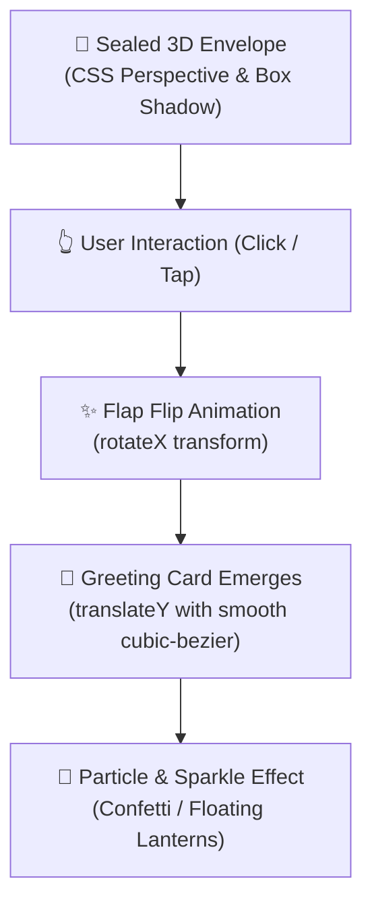

# 🌙 Eid Gift Card — Interactive 3D/2D Animated Greeting

  <b>A celebratory, interactive greeting card featuring realistic 3D envelope-opening physics, smooth CSS perspective transforms, and celebratory particle animations.</b>

---

## ✨ Visual Effects & Mechanics

---

## 🛠️ Tech Highlights

- **CSS 3D Transforms**: `perspective`, `transform-style: preserve-3d`, and `rotate3d` creating realistic depth without heavy 3D rendering engines.
- **Micro-Interactions**: Hover lighting reflections and fluid card extraction transitions.
- **Pure Vanilla Web Stack**: Zero external runtime overhead; opens directly in any modern browser.

---

## 👨‍💻 Author

**Momin Rifat**  
GitHub: [@MominRifat](https://github.com/MominRifat)
